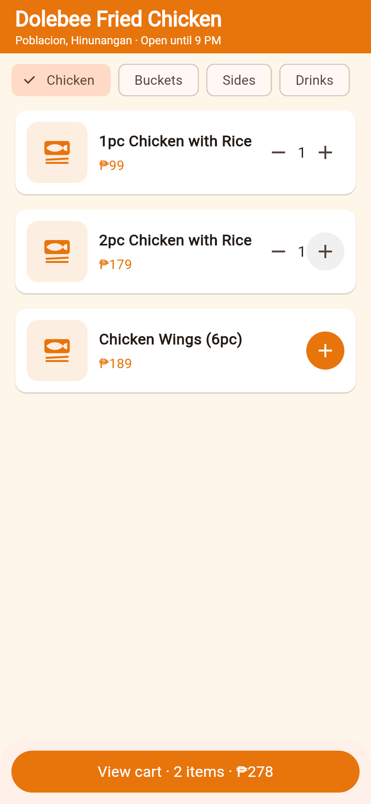
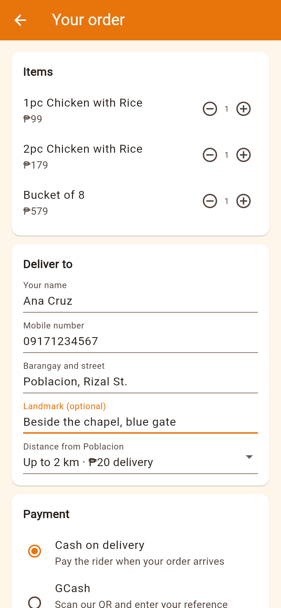
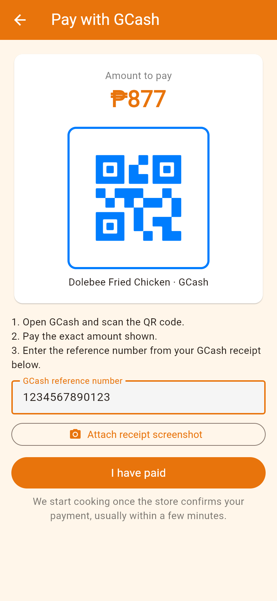
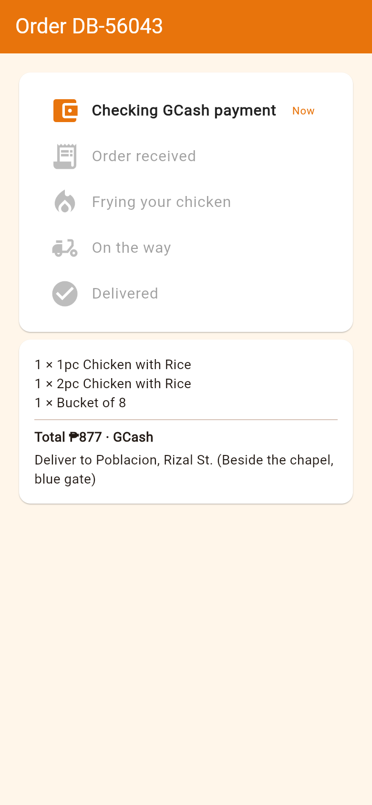

# Dolebee ordering app

Phone ordering and delivery app for Dolebee fried chicken in Poblacion, Hinunangan, Southern Leyte. One Flutter app (Android first) on Firebase, with three roles: customer, owner, and delivery staff.

## What is here

- `lib/models/` holds menu items, orders, and delivery zones (PHP 20 up to 2 km, PHP 40 up to 5 km, PHP 60 up to 8 km).
- `lib/services/daily_sales.dart` computes the owner's daily sales and the monthly app fee.
- `firestore.rules` restricts who can read and change orders and menu items.
- `test/` covers zone fees, daily sales, and the app fee.

Payments at launch: GCash by manual QR (customer enters the GCash reference number, owner confirms) and cash on delivery.

## Screens

| Menu | Cart | GCash payment | Order status |
| --- | --- | --- | --- |
|  |  |  |  |

The menu uses sample items and prices until the owner's real menu is loaded from Firebase.

## Getting started

1. Install Flutter: https://docs.flutter.dev/get-started/install
2. Create a Firebase project, then run `dart pub global activate flutterfire_cli` and `flutterfire configure`.
3. `flutter pub get`, then `flutter test` and `flutter run`.
